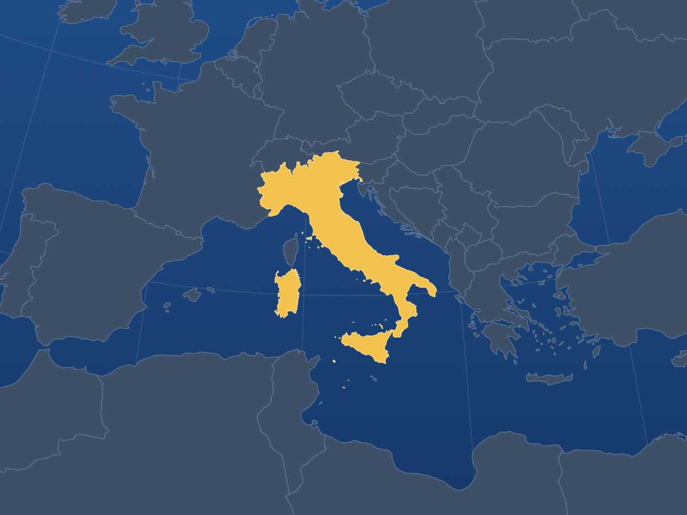

# Cartes / Maps

**Reconnaître un lieu. Apprendre son nom.** 288 questions géographiques : pays, territoires et régions nommées, en français ou en anglais, pour Anki.

[English](README.md) · [Construire les jeux](#construire-pour-anki) · [Sources et limites](docs/sources.fr.md) · [CC BY 4.0](LICENSE)



*Une carte au recto. Son nom au verso. Ici, Italie / Italy.*

## Ce que vous obtenez

| Langue | Jeu dans Anki | Cartes | Fichier produit |
| --- | --- | ---: | --- |
| English | Maps | 288 | `Maps-en-288.apkg` |
| Français | Cartes | 288 | `Cartes-fr-288.apkg` |

Choisissez une langue ou installez les deux. Les paquets partagent leurs images et leur géométrie, mais leurs identités de notes sont distinctes : les révisions restent indépendantes. Chaque paquet contient toutes ses images ; aucun compte ni application RectoVerso n’est nécessaire pour étudier dans Anki.

Ce jeu conserve les **249 identités de cartes de pays et territoires ISO** et ajoute **39 questions sur des régions nommées**, soit **288 cartes par langue**. La France et le Portugal présentent désormais leur partie métropolitaine ou continentale, les régions éloignées ayant leurs propres questions. Les autres entrées ISO composites gardent leur vue d’ensemble et reçoivent des questions régionales. **Il ne s’agit pas de 288 pays.** Les régions supplémentaires ont des codes propres au jeu, sans se faire passer pour des codes ISO. Les noms usuels sont distincts des noms formels de l’ISO. [Lire la convention de couverture et de limites](docs/sources.fr.md), notamment le traitement neutre du Cachemire et d’Abyei.

**Revue de publication bloquée :** le propriétaire doit accepter la migration manuelle Anki, ou une correction compatible avec le réglage par défaut doit être vérifiée. **Cette branche construit le candidat non publié 0.4.0-rc.1.** Le téléchargement ci-dessous reste 0.3.0-rc.1. Le candidat ajoute les continents recherchables sans changer les 288 questions ni leurs identités. Dans une collection Anki existante, cette migration nécessite **Fusionner les types de notes + Toujours mettre à jour les notes et leurs types** ; sauvegarder ses modifications personnelles. [Convention, preuves et procédure](docs/continent-search.fr.md).

**Télécharger [0.3.0-rc.1 — 288 cartes](https://github.com/rectoversohq/rectoverso-maps/releases/tag/v0.3.0-rc.1) :** [Français · Cartes](https://github.com/rectoversohq/rectoverso-maps/releases/download/v0.3.0-rc.1/Cartes-fr-288.apkg) · [English · Maps](https://github.com/rectoversohq/rectoverso-maps/releases/download/v0.3.0-rc.1/Maps-en-288.apkg). Il s’agit d’une préversion. Importez le `.apkg` dans Anki ou sélectionnez son étiquette immuable avant de construire. Les notes de version donnent les empreintes exactes et les contrôles réalisés. La mise à jour depuis [0.2.0-rc.2 (249 cartes)](https://github.com/rectoversohq/rectoverso-maps/releases/tag/v0.2.0-rc.2) conserve les identités et les progrès ; 39 nouvelles questions sont ajoutées. Les étiquettes et fichiers publiés restent immuables.

## Construire pour Anki

La fabrication utilise les images déjà présentes dans ce dépôt. **Ni Node, ni Swift, ni téléchargement de données cartographiques ne sont nécessaires pour cette étape.**

Prérequis : Git, Bash et **Python 3.14**, avec `venv` et `pip`. La procédure est testée sur macOS avec la bibliothèque Python d’Anki figée à **26.9.3**. Les autres systèmes n’ont pas été vérifiés. Anki desktop permet d’étudier le jeu obtenu, mais n’a pas besoin d’être lancé pendant sa fabrication.

Clonez le dépôt et créez l’environnement. Ces instructions décrivent cette révision ; les anciennes étiquettes conservent leur propre README. Si vous disposez déjà de ces sources, commencez par `cd` :

```sh
git clone https://github.com/rectoversohq/rectoverso-maps.git
cd rectoverso-maps
python3.14 -m venv .venv
.venv/bin/python -m pip install -r requirements.txt
```

Pour construire les sources exactes de la release, exécutez `git switch --detach v0.3.0-rc.1` après le clonage. Pour le développement courant, restez sur `main`. Consultez `rectoverso.json` pour connaître la version et le nombre de cartes de la révision construite.

Construisez les deux langues dans un **nouveau dossier hors du dépôt**. Les SVG originaux occupent une place importante ; prévoyez de l’espace pour les sources, les paquets et les fichiers temporaires. Remplacez le chemin d’exemple par un chemin sur votre disque de données :

```sh
ANKI_PYTHON="$PWD/.venv/bin/python" ./scripts/build.sh /chemin/absolu/vers/cartes-build
```

La commande vérifie les sources, crée les deux fichiers `.apkg` et leurs métadonnées `.rectoverso.json`, puis importe chaque paquet avec la bibliothèque d’Anki. Elle contrôle le nombre de cartes, les rectos et versos rendus, les médias manquants, l’unicité des notes et la conservation des progrès lors d’un nouvel import. Les résultats sont enregistrés dans `evidence/anki-validation.json`, dans le dossier de sortie. Un contrôle échoué interrompt la commande avec une erreur ; gardez ses résultats pour le diagnostic et utilisez un nouveau dossier pour réessayer.

Ouvrez le `.apkg` de la langue choisie dans Anki desktop. Les fichiers `.rectoverso.json` sont des métadonnées de fabrication : **ne les importez pas**. Conservez les paquets intacts afin que leurs identités stables puissent préserver vos progrès lors des mises à jour.

## Modifier les sources

Les images, les données géographiques et les outils sont partagés. Les définitions françaises et anglaises vivent à côté :

```text
rectoverso.json          Métadonnées communes, version et paquets par langue
source/
  places.json           Noms bilingues, GUID stables et géométrie des lieux
  media/                Cartes PNG prêtes à empaqueter
  languages/en/         Jeu, type de note et traductions en anglais
  languages/fr/         Jeu, type de note et traductions en français
  style.css             Apparence Anki commune
  geography/            Couverture, références et données cartographiques
artwork/svg/            Dessins vectoriels originaux modifiables
scripts/
  build.sh              Construire et vérifier les deux langues
  source_data.py        Composer les notes communes et localisées
  ci.py                 Exécuter toute la suite CI Anki
  checks/               Vérifier sources, paquets et identités
  maps/                 Outils cartographiques et dépendances Node
tests/                  Tests des sources, des identités et du rendu
docs/                   Guides de fabrication et sources en deux langues
.github/workflows/      Configuration de GitHub Actions
```

Modifiez les contenus dans `source/`, les outils dans `scripts/` et leurs tests de régression dans `tests/`. La génération des cartes est facultative pour empaqueter les images stockées. Les résultats de fabrication et les caches restent hors du dépôt.

La [référence de fabrication et de vérification](docs/building.fr.md) couvre les tests, la régénération des images, les identités et le schéma des métadonnées. Les [notes sur les sources et les limites](docs/sources.fr.md) expliquent les choix cartographiques et les crédits. Toute contribution doit préserver les identités des notes, jeux, modèles, champs et modèles de cartes ; discutez les changements de couverture, de noms et de limites avant de les modifier.

## Licence et crédits

Nos contenus originaux, cartes, métadonnées et outils sont **© Simon Pinkas, CC BY 4.0**. Vous pouvez les partager et les adapter, y compris commercialement, selon les conditions d’attribution et les autres termes de cette licence. Créditez l’auteur, liez la licence et indiquez vos modifications. [LICENSE](LICENSE) contient la licence complète ; [NOTICE.md](NOTICE.md) précise son périmètre et les crédits des sources. Les dépendances conservent leurs propres licences.

La géométrie vient principalement de **Natural Earth 5.1.2** (domaine public). Les îles McDonald utilisent le littoral de **Geoscience Australia / Australian Antarctic Data Centre** (CC BY 4.0). Certains noms usuels proviennent d’**Ultimate Geography 5.3** (texte dans le domaine public) ; aucune de ses images n’est réutilisée. Chaque image produite est créditée dans `imageCredits`, dans `rectoverso.json`. [Détail des sources](docs/sources.fr.md#crédits-et-licence).
